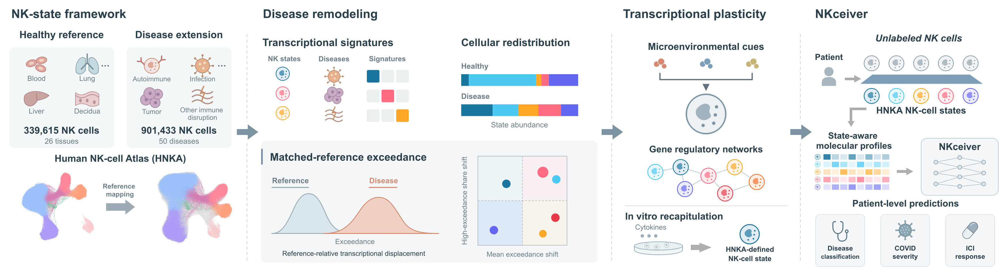
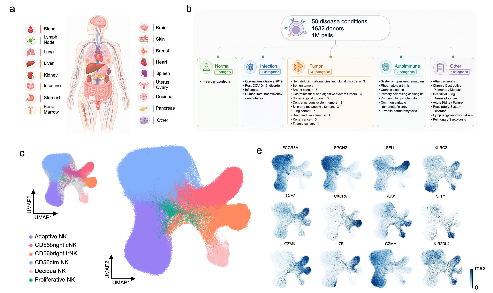

# HNKA

HNKA is a single-cell atlas of human natural killer cells across tissues and disease contexts. This repository provides code for mapping new samples to the atlas and analyzing changes in NK-cell states. [Preprint](https://doi.org/10.64898/2026.10.22.760478)

[](assets/Overview.png)

<details>
<summary>HNKA disease extension</summary>

[](assets/HNKAd.png)

The collection comprises approximately 1 million cells, with 901,433 NK cells retained after quality control.

</details>

## Installation

Use Python 3.10.

```bash
git clone https://github.com/F1Meng/HNKA.git
cd HNKA
python -m pip install -r scripts/requirements.txt
python -m pip install -r scripts/requirements-mapping.txt
```

## Usage

Set the input and reference paths in `scripts/configs/external_query.yaml`, then map and analyze the query.

```bash
python scripts/run_exceedance.py map --config scripts/configs/external_query.yaml
python scripts/run_exceedance.py analyze --config scripts/configs/external_query.yaml
```

For donor-level disease classification, COVID-19 severity and ICI response prediction, see [NKceiver](https://github.com/F1Meng/NKceiver).

## Data

Atlas data and pretrained models will be made publicly available on Hugging Face upon publication.

## Citation

If you use HNKA in your research, please cite our preprint:

> Meng, F., Lin, P., Zhang, S., Li, T., Liu, Z., Ye, P., Zhong, C. & Zhou, Y. **Disease-associated NK-cell state remodeling reveals transcriptional profiles predictive of clinical phenotypes.** *bioRxiv* (2026). [doi:10.64898/2026.10.22.760478](https://doi.org/10.64898/2026.10.22.760478).

<details>
<summary>BibTeX</summary>

```bibtex
@article{meng2026hnka,
  author = {Meng, Fanyi and Lin, Peiran and Zhang, Shunjie and Li, Tianhao and Liu, Zili and Ye, Peng and Zhong, Chao and Zhou, Yuan},
  title = {Disease-associated {NK}-cell state remodeling reveals transcriptional profiles predictive of clinical phenotypes},
  journal = {bioRxiv},
  year = {2026},
  doi = {10.64898/2026.10.22.760478},
  url = {https://doi.org/10.64898/2026.10.22.760478}
}
```

</details>

## License

[MIT](LICENSE).
